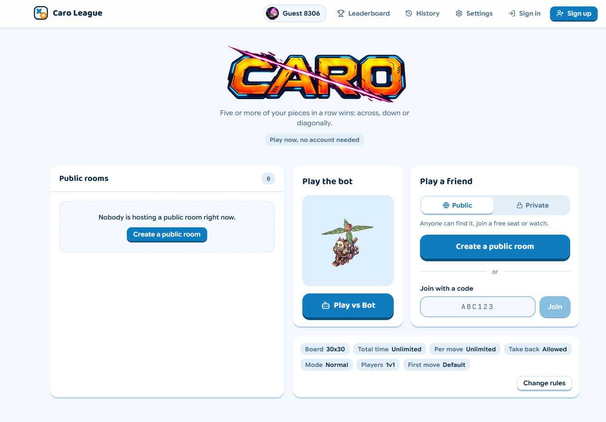
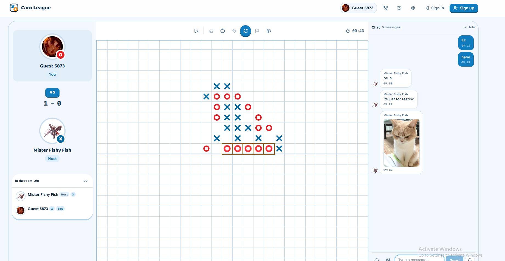
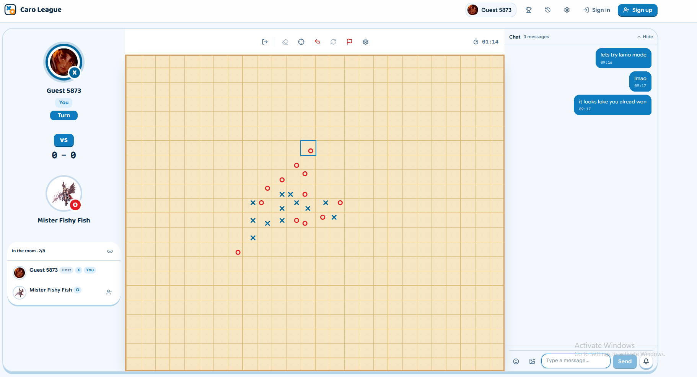
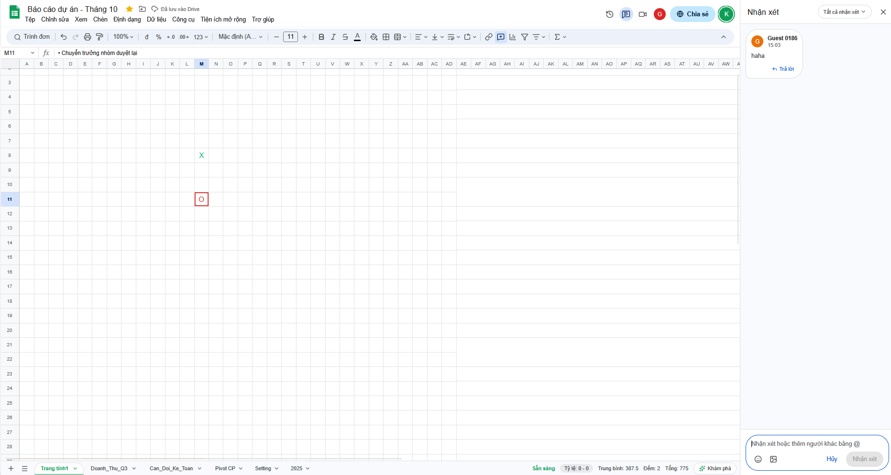

# [Caro Web App](https://league-of-caro.vercel.app/)

> 🇬🇧 English version: [README.md](README.md)

[](https://nodejs.org/)
[](https://react.dev/)
[](https://www.typescriptlang.org/)
[](https://tailwindcss.com/)
[](https://supabase.com/)
[](https://peerjs.com/)
[](https://vitest.dev/)

Ứng dụng web **Caro (Gomoku / Five-in-a-Row)** thời gian thực, xây dựng bằng **React 19**, **TypeScript**, **Tailwind CSS v4** và **WebRTC (PeerJS)**. Người chơi gặp nhau trong các phòng ngang hàng (peer-to-peer), còn **Supabase** đảm nhiệm tài khoản, điểm ELO, lịch sử trận đấu và bảng xếp hạng.

---

## Tính năng

### Chế độ chơi
- **1v1 Classic**: năm quân liên tiếp là thắng
- **1v1v1**: ba người chơi với quân hình tam giác, bốn quân liên tiếp là thắng
- **Chế độ Lmao**: mỗi nước đi rơi vào một trong chín góc của ô cờ
- **Luyện tập**: chơi với bot, ở dạng hai người hoặc ba người
- **Kích thước bàn cờ** 15, 19, 30 và 50, với đồng hồ tổng thời gian và đồng hồ theo từng nước đi (hoặc không giới hạn thời gian)
- **Tung đồng xu và Kéo Búa Bao**: các trò chơi arcade phong cách retro để quyết định lượt đi trước

### Phòng chơi
- **Phòng mở** có chỗ ngồi, người xem và trung tâm điều khiển của chủ phòng, tham gia bằng mã phòng hoặc từ danh sách phòng công khai
- **Ngồi vào chỗ** ngay giữa phòng: người xem có thể ngồi xuống khi còn chỗ trống
- **Quyền chủ phòng**: cập nhật luật chơi, đuổi thành viên, dọn chỗ ngồi
- **Kết nối lại**: người chơi bị mất kết nối giữ nguyên chỗ ngồi tối đa năm giờ và tiếp tục từ nơi đã dừng
- **Xử thắng**: nếu đối thủ vắng mặt quá hai phút, người chơi còn lại có thể kết thúc ván đấu với kết quả thắng
- **Đồng hồ riêng cho từng người chơi** và thời gian suy nghĩ tích lũy cho mỗi chỗ ngồi
- **Đi lại nước (take-back)**: tức thì trong vòng năm giây sau nước đi của bạn, nếu không thì đối thủ phải đồng ý

### Double down
- Mỗi người chơi có thể đề nghị **Double down** một lần mỗi ván, bằng nút xúc xắc màu cam cạnh biểu tượng bánh răng cài đặt
- Lời đề nghị xuất hiện trong khung chat với hai nút **Accept** và **Reject**. Từ chối không thay đổi gì và ván đấu tiếp tục
- Người nhận lời đề nghị có năm nước đi của riêng mình để trả lời; sau nước đi thứ năm, đề nghị sẽ tự động bị từ chối
- Khi được chấp nhận, xúc xắc sẽ **cháy** trong suốt phần còn lại của ván, người thắng được cộng thêm và người thua bị trừ thêm **20 điểm xếp hạng**
- Điểm thưởng được áp dụng ở phía máy chủ và chỉ khi cả hai người chơi đã đồng ý thông qua phiên đăng nhập của chính mình, nên không ai có thể áp đặt lên người kia
- Có trong các ván 1v1 trực tuyến; không hiển thị cho người xem, trong chế độ luyện tập hoặc trong 1v1v1

### Chat
- Chat phòng trực tiếp với **trả lời và trích dẫn** (chạm vào phần trích dẫn để nhảy đến tin nhắn gốc)
- Đính kèm ảnh, meme và GIF, gửi trực tiếp kể cả giữa ván; nhấp vào bất kỳ ảnh nào để xem kích thước đầy đủ
- Biểu tượng cảm xúc động kiểu Yahoo Messenger với phím tắt văn bản như `=))`
- Phản ứng nhanh, buzz và trêu chọc nhắm vào một người chơi
- Âm thanh và chỉ báo tin nhắn chưa đọc

### Ngụy trang bảng tính (phím tắt sếp)
- Chọn giao diện bàn cờ **Spreadsheet** và trận đấu sẽ được ngụy trang thành một tệp Google Sheets: thanh công cụ, menu, các tab trang tính và lưới ô trải rộng ra ngoài bàn cờ
- **Ctrl+Q** là phím tắt sếp: chuyển tức thì giữa bàn cờ và một báo cáo tài chính giả trông rất thuyết phục, kể cả khi bạn đang gõ chữ
- Khung chat trở thành bảng **Comments** với avatar chữ cái, trả lời, biểu tượng cảm xúc và ảnh đính kèm (nhấp để phóng to)
- **Ctrl+`** mở và đóng bảng bình luận (Ctrl+Alt+M cũng dùng được); khi mở, con trỏ nằm sẵn trong ô bình luận
- Các phím tắt khác của Sheets được ánh xạ sang thao tác trong game: Ctrl+Z đi lại nước, Ctrl+Y chơi lại, Ctrl+plus / Ctrl+minus / Ctrl+0 để thu phóng, Ctrl+/ hiển thị toàn bộ phím tắt
- Âm thanh trò chơi được tắt khi báo cáo giả đang hiển thị trên màn hình

### Điểm xếp hạng và cấp bậc
- **Điểm ELO** (hệ số K bằng 32) được tính ở máy chủ, không bao giờ do máy khách tính
- **Các cấp bậc có huy hiệu**: Cardboard, Plastic, Stone, Wood, Bronze, Silver, Gold, Diamond, Platinum, Uranium, Master và Grand Master, hiển thị trên thanh điều hướng, hồ sơ và bảng xếp hạng
- **Bảng xếp hạng** kèm hướng dẫn cấp bậc giải thích từng bậc
- **Lịch sử trận đấu** và hồ sơ với thống kê cùng lựa chọn avatar
- **Kết quả chống gian lận**: kết quả có lợi cho người báo cáo được giữ dưới dạng khiếu nại (claim), chỉ được ghi nhận sau mười phút nếu không bị phản đối, và chỉ khi cả hai người chơi đều có vé chỗ ngồi (seat ticket) cho ván đấu

### Kết nối và hỗ trợ VPN
- Các peer kết nối trực tiếp qua WebRTC, chuyển sang **TURN relay** khi không thể kết nối trực tiếp
- **Hoạt động sau VPN và mạng hạn chế** (như Cloudflare 1.1.1.1 / WARP): relay truy cập được qua TLS trên cổng 443
- Thông tin xác thực ngắn hạn được cấp bởi hàm serverless `/api/turn` sử dụng khóa **Cloudflare TURN**, nên API token luôn nằm ở máy chủ và không bao giờ đi kèm trong bundle
- Có thể dùng relay TURN tĩnh thay thế (xem [Biến môi trường](#3-cấu-hình-biến-môi-trường))

### Giao diện
- Tọa độ, mô phỏng nước đi, tùy chọn hiển thị (tọa độ, đánh dấu nước đi cuối, âm thanh)
- Giao diện bàn cờ (giấy kẻ ô, tre, lưới laser, bảng tính), kiểu quân cờ và màu quân cờ tùy chỉnh
- Giao diện sáng và tối theo cài đặt hệ thống của bạn
- Bố cục responsive xuống tới điện thoại 320px, với khung chat dạng modal trên di động
- Tôn trọng `prefers-reduced-motion`

---

## Xem trước









---

## Bắt đầu nhanh

### 1. Yêu cầu hệ thống
- [Node.js](https://nodejs.org/) 20.19 trở lên
- `npm` hoặc `pnpm`

### 2. Clone và cài đặt thư viện
```bash
git clone https://github.com/voanhduy1710/Caro-app.git
cd Caro-app
npm install
```

### 3. Cấu hình biến môi trường
Sao chép tệp môi trường mẫu và điền thông tin xác thực của bạn:
```bash
cp .env.example .env
```
Chỉnh sửa `.env`:
```env
# Optional Vercel token for CLI deployment
VERCEL_ACCESS_TOKEN=your_vercel_token_here

# Supabase Project Configuration
VITE_SUPABASE_URL=https://your-project-id.supabase.co
VITE_SUPABASE_ANON_KEY=your_supabase_anon_key_here

# Cloudflare TURN (recommended, for players on VPNs or strict NATs).
# Dashboard > Realtime > TURN Server > create key. Server-side secrets read by api/turn.js.
CLOUDFLARE_TURN_KEY_ID=
CLOUDFLARE_TURN_API_TOKEN=

# Alternative: a static TURN relay that listens on TLS/TCP 443.
# Comma-separated URLs, e.g. turns:turn.example.com:443?transport=tcp,turn:turn.example.com:3478
VITE_TURN_URLS=
VITE_TURN_USERNAME=
VITE_TURN_CREDENTIAL=
```
Nếu không có bất kỳ thiết lập TURN nào, ứng dụng vẫn hoạt động, nhưng người chơi dùng VPN hoặc sau mạng hạn chế có thể không kết nối được với nhau.

### 4. Chạy cục bộ
Khởi động máy chủ phát triển:
```bash
npm run dev
```
Mở [http://localhost:5175](http://localhost:5175) trong trình duyệt.

---

## Triển khai

Ứng dụng gồm hai phần được triển khai riêng biệt.

**Frontend và `/api/turn` (Vercel)**

```powershell
.\deploy_vercel.ps1
```
Script đồng bộ các thiết lập Supabase và TURN lên dự án Vercel, chạy kiểm tra build production, rồi xuất bản bằng CLI.

**Cơ sở dữ liệu và edge functions (Supabase)**

Áp dụng lần lượt các tệp SQL trong `supabase/migrations/`, và triển khai các hàm trong `supabase/functions/`:

```bash
npx supabase functions deploy seat-ticket submit-match --project-ref <your-project-ref>
```

CLI cần được đăng nhập (`npx supabase login`, hoặc biến môi trường `SUPABASE_ACCESS_TOKEN`) bằng tài khoản là thành viên của dự án.

---

## Script hỗ trợ PowerShell

Dành cho lập trình viên Windows, các quy trình PowerShell tự động được cung cấp ở thư mục gốc của repository:

- **`.\deploy_local.ps1`**: Cài đặt thư viện (nếu thiếu) và khởi động máy chủ phát triển Vite trên cổng cố định `5175`.
- **`.\clean_restart.ps1`**: Kết thúc êm các tiến trình mồ côi đang chiếm cổng `5175` trước khi khởi chạy một phiên phát triển mới.
- **`.\deploy_vercel.ps1`**: Đồng bộ biến môi trường, chạy kiểm tra build production (`npm run build`) và xuất bản lên Vercel bằng CLI token.

---

## Kiểm thử & Chất lượng mã nguồn

```bash
# Run unit tests via Vitest
npm test

# Run the Room Engine headless E2E simulation suite
npm run e2e:room

# Run fast linter checks via Oxlint
npm run lint

# Check TypeScript types and build bundle
npm run build
```

---

## Cấu trúc dự án

```text
Caro-app/
├── api/                  # Vercel serverless functions (TURN credentials)
├── public/               # Static assets, sound effects, avatars, rank badges & minigame sprites
├── scripts/              # E2E room tests and data maintenance scripts
├── src/
│   ├── app/              # Root App, View routing & layout wrappers
│   ├── config/           # Application & Supabase client configuration
│   ├── features/
│   │   ├── auth/         # Supabase Auth provider, modals & credentials management
│   │   ├── avatar/       # Avatar selection & storage bucket integration
│   │   ├── game/         # Board, controls, action rail, chat & AI engine
│   │   ├── history/      # Match history, rated result submission & claims
│   │   ├── leaderboard/  # ELO leaderboard, rank guide & rank tracking
│   │   ├── minigames/    # Retro Coin Flip & Stone RPS pre-match turn deciders
│   │   ├── profile/      # Player profile modal & stat editor
│   │   ├── room/         # P2P room engine, protocol, host hub, ratings & roster
│   │   ├── settings/     # Room settings & board theme preferences
│   │   ├── theme/        # Theme provider & UI theme switches
│   │   └── webrtc/       # PeerJS connection orchestration, ICE servers & room discovery
│   ├── shared/           # Reusable UI components, hooks, sound triggers & utilities (ELO, rank tiers)
│   ├── styles/           # Tailwind CSS v4 design tokens, motion and global themes
│   └── main.tsx          # Application entry point
├── supabase/
│   ├── functions/        # Edge functions: submit-match, seat-ticket
│   └── migrations/       # SQL migrations (RLS, seat tickets, claims, double down)
└── package.json          # Project metadata and dependencies
```
